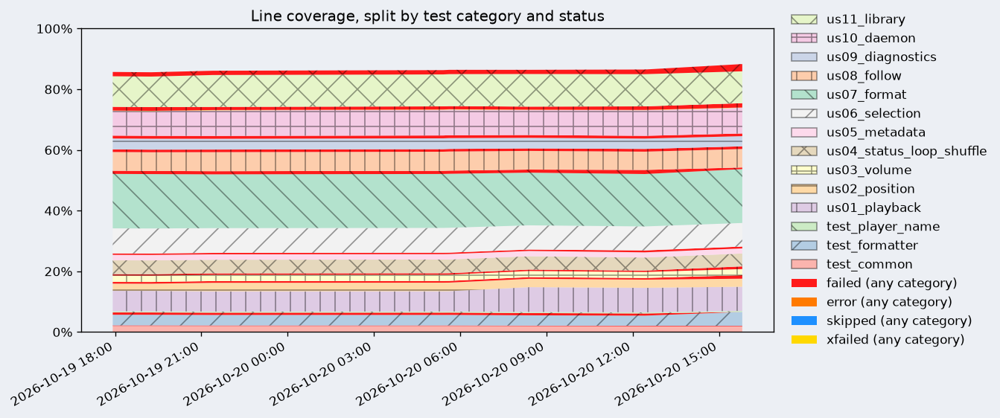

# Playerctl

<!-- Badges: project status -->

[](https://github.com/5mdt/playerctl/actions/workflows/ci.yml) [](https://5mdt.github.io/playerctl/) [](https://codecov.io/gh/5mdt/playerctl/tree/develop) [](https://github.com/5mdt/playerctl/tags) [](LICENSE.md) 

<!-- Badges: build tooling -->

[](https://mesonbuild.com/) [](https://docs.astral.sh/uv/)

<!-- Badges: requirements and specifications -->

[](https://docs.gtk.org/glib/) [](https://specifications.freedesktop.org/mpris-spec/latest/)

<!-- Section: introduction -->

Playerctl is a command-line utility and library for controlling media players that implement the [MPRIS](http://specifications.freedesktop.org/mpris-spec/latest/) D-Bus Interface Specification. Playerctl makes it easy to bind player actions, such as play and pause, to media keys. You can also get metadata about the playing track such as the artist and title for integration into statusline generators or other command-line tools.

Playerctl also comes with a daemon that allows it to act on the currently active media player called `playerctld`.

<!-- Section: fork disclaimer -->

## Disclaimer

> They would call this fork LLM-slop - they would be right. LLM code varies from shit to mediocre and this repo would be mediocre at best.
>
> Playerctl is one of the pillars in Linux desktop setups, but now it's abandoned for years.
>
> I'm forking it to keep it working and maintained. I use LLMs to help with development.
>
> But LLM usage here has standards:
> - **Specification compliance:** Follow existing specs and established standards first.
> - **Portability and maintainability:** Keep the code consistent, simple, and maintainable.
> - **KISS and DRY apply.** Every change must serve a purpose.
>
> A maintained project that follows its specifications is better than an abandoned one.
>
> If you hate LLMs so much that my fork would make you your own fork with no llm-code and maintain it, i would be extremely happy about it and tribute your right here.

<!-- Section: quick start -->

## Quick start

```bash
# Toggle play/pause on the first player found
playerctl play-pause

# Print "artist - title" of the current track
playerctl metadata --format '{{ artist }} - {{ title }}'
```

<!-- Section: test coverage -->

## Test coverage

 [](https://codecov.io/gh/5mdt/playerctl/tree/develop)

<!-- Section: documentation index -->

## Documentation

- [Installing](doc/installing.md) - packages and building from source
- [Usage](doc/usage.md) - commands, selecting players, formatting, following changes
- [Troubleshooting](doc/troubleshooting.md) - debug logging, missing players, `playerctld` autostart
- [Using the library](doc/library.md) - GObject introspection bindings and example scripts
- [API reference](https://5mdt.github.io/playerctl/) - generated from the C sources
- [Changelog](doc/CHANGELOG.md) - what changed in each release
- [Releasing](doc/releasing.md) - release candidates and releases from the GitHub UI

<!-- Section: external articles -->

## Resources

Check out the following articles about Playerctl:

- [2 new apps for music tweakers on Fedora Workstation - Fedora Magazine](https://fedoramagazine.org/2-new-apps-for-music-tweakers-on-fedora-workstation/ "2 new apps for music tweakers on Fedora Workstation")
- [Playerctl at Version 2.0](https://dubstepdish.com/index.php/2018/10/21/playerctl-at-version-2-0/)

<!-- Section: license and copyright -->

## License

This work is available under the GNU Lesser General Public License (See [LICENSE.md](./LICENSE.md)).

Copyright © 2014, Tony Crisci and [contributors](./CONTRIBUTORS.md)

Copyright © 2026, 5mdt fork [contributors](./CONTRIBUTORS.md)
